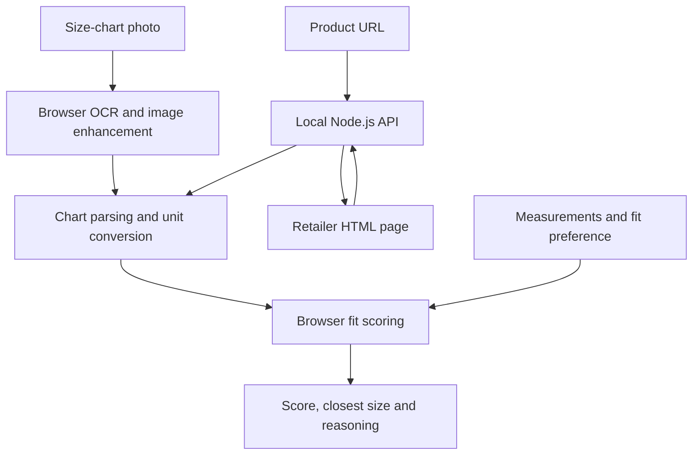

<div align="center">


# Fitcheck

**Stop guessing. Start fitting.**

A digital fitting studio that compares your measurements with a brand’s size chart to find your closest size.


[Getting started](#-getting-started) · [Features](#-highlights) · [Architecture](#-architecture) · [Testing](#-testing) · [Roadmap](#-roadmap)

</div>

> [!NOTE]
> Fitcheck provides **rule-based fit estimates**, not a guarantee of comfort or sizing accuracy. Photo recognition uses OCR; uploaded charts do not train a model.

---

## ✨ Highlights

<table>
<tr>
<td width="33%" valign="top">

### 📏 Your measurements
Enter body measurements in centimetres or inches. Choose close, regular or relaxed fit, and save your profile in the current browser.

</td>
<td width="33%" valign="top">

### 📷 Read a size chart
Upload a chart photo. The reader enhances small text, reconstructs table rows and rereads uncertain numeric cells before comparing sizes.

</td>
<td width="33%" valign="top">

### 🧵 A fitting studio
An open specification-sheet layout, oversized type and a garment illustration with rotation controls and measurement guides.

</td>
</tr>
<tr>
<td valign="top">

### 🔗 Import a product
Paste a public HTTPS product link to look for an accessible HTML size table. Failed imports keep your existing chart intact.

</td>
<td valign="top">

### 🎯 See your closest size
Get a fit score, the closest chart size and measurement-level reasoning. Missing measurements reduce the reported confidence.

</td>
<td valign="top">

### ⚡ Compare in the browser
Chart parsing and scoring run locally after the page loads. Photo comparisons continue if the backend stops; link imports need it running.

</td>
</tr>
</table>

<details>
<summary><b>Explore all features</b></summary>

| Area | Current behaviour |
|---|---|
| **Measurements** | Height, chest, waist, hips, shoulders, desired top length and inseam, with numeric validation. |
| **Units** | Convert body inputs between cm and inches; detect chart units and ask for confirmation when uncertain. |
| **Filters** | Women / men and tops / bottoms selections, with checks against recognized chart content. |
| **Fit preference** | Close, regular and relaxed preferences adjust the garment ease used in scoring. |
| **Photo input** | PNG, JPG and WebP up to 10 MB; file selection, drag and drop, image preview and removal. |
| **Chart layouts** | Parse supported tables with sizes down the first column or across the header row. OCR success still depends on layout and image quality. |
| **Results** | Score out of 100, closest size, fit label, confidence and an expandable breakdown of chart sizes. |
| **Saved profile** | Measurements and preference stored in browser local storage; clear-data control removes the saved profile. |
| **Interaction** | Garment rotation/reset, focus-driven measurement guides, processing feedback, keyboard focus styles and reduced-motion support. |
| **Recovery** | Distinguish server connection problems from chart-reading failures, and preserve the loaded chart when a product import fails. |

</details>

---

## 🧭 How it works

1. **Measure yourself.** Enter your chest measurement for tops or waist for bottoms. Add relevant measurements to refine the comparison.
2. **Choose your fit.** Select the clothing category, gender filter and preferred fit.
3. **Bring the chart.** Upload a size-chart image or import an accessible product table from a link.
4. **Compare sizes.** Review the score and closest size, then expand the details to see where the garment may feel tight, loose, short or long.

The scoring logic distinguishes **finished garment measurements** from **body-size ranges**. Garment charts are compared using general ease allowances; body charts are compared against the listed body ranges. A score is a heuristic comparison, not a probability.

---

## 🏗 Architecture

A small Node.js HTTP server serves the interface and handles retailer imports. The browser performs OCR, chart parsing and fit scoring, reusing the same parsing and scoring modules exposed by the server API.



| File | Responsibility |
|---|---|
| [`server.mjs`](server.mjs) | Static routes, health check, product import, parsing and comparison endpoints. |
| [`extract.mjs`](extract.mjs) | HTML metadata extraction and size-chart parsing, including supported transposed tables. |
| [`fit.mjs`](fit.mjs) | Shared fit scoring, garment ease, body ranges and measurement reasoning. |
| [`public/app.js`](public/app.js) | Form state, photo preparation, OCR reconstruction, chart selection and result rendering. |
| [`public/api-client.mjs`](public/api-client.mjs) | Product-import requests, timeout handling and useful connection errors. |
| [`public/style.css`](public/style.css) | Studio styling, responsive layouts, interaction states and reduced-motion rules. |
| [`start-fitcheck.mjs`](start-fitcheck.mjs) | Startup health check, server launch and Windows browser opening. |
| [`test/`](test/) | Scoring, parsing, OCR reconstruction, API and recovery tests. |

<details>
<summary><b>Technology stack</b></summary>

| Layer | Technology |
|---|---|
| Interface | Semantic HTML, CSS and vanilla JavaScript modules |
| Runtime | Node.js 22+ and built-in HTTP, HTTPS and DNS modules |
| Recognition | Tesseract.js 5.1.1, loaded on demand from a CDN |
| Image preparation | Browser Canvas and ImageBitmap APIs |
| Persistence | Browser local storage |
| Testing | Built-in Node.js test runner and assertions |
| Visual interaction | Lightweight SVG/CSS garment with perspective and measurement guides |

There is no frontend framework, database, API key or server npm dependency required for the current implementation.

</details>

---

## 🚀 Getting started

**Requirement:** Node.js 22 or newer.

```bash
git clone https://github.com/KevinDhyanesh/FitCheck.git
cd FitCheck
npm start
```

Open **http://127.0.0.1:3000/**. Keep the server terminal open while using the app.

### Windows quick start

Double-click **[`Start Fitcheck.cmd`](Start%20Fitcheck.cmd)** in the downloaded project folder. It starts the server and opens the browser when ready. If Fitcheck is already running and responds to its health check, the launcher reuses it.

In PowerShell, you can also run:

```powershell
npm.cmd start
```

> [!IMPORTANT]
> Closing the server terminal stops product-link imports. A page that is already open may still display the interface and run photo comparisons. Start Fitcheck again before importing another link.

<details>
<summary><b>Use a different port</b></summary>

```powershell
$env:PORT="3001"
npm.cmd start
```

Open the address printed by the server. The default port is 3000.

</details>

<details>
<summary><b>Troubleshooting</b></summary>

| Message or problem | What to do |
|---|---|
| **Cannot reach its server / connection refused** | Run the launcher or `npm.cmd start` in the project folder. Keep that terminal open, then reload the app. |
| **PowerShell blocks npm.ps1** | Use `npm.cmd start` or `node server.mjs`. |
| **Port already in use** | Reuse the running Fitcheck instance, stop the conflicting application, or choose another port. |
| **Store unavailable / request timed out** | Check the server’s internet connection. Some retailer pages block automated access or load charts with JavaScript; upload the chart photo instead. |
| **Photo reader cannot load** | Internet access is needed to load Tesseract.js and its worker/language assets. Check the connection and retry. |
| **Chart rows could not be read reliably** | Use a larger screenshot cropped to one chart. Keep headers, units and all size rows visible. |
| **Chart unit is uncertain** | Confirm inches or centimetres using the unit-choice buttons. |

</details>

---

## 🧪 Testing

```bash
npm test
```

On Windows PowerShell, use `npm.cmd test` if script execution is restricted.

The suite currently contains **20 tests**, covering:

- Garment ease, body ranges, tight-fit penalties and missing-measurement handling.
- Inch conversion, HTML extraction, transposed tables and sleeve-length separation.
- OCR row reconstruction, targeted numeric rereading and missing-size detection.
- Server routes, private-address rejection, origin checks and HTTPS validation.
- Offline API errors, static-server responses and store error messages.

These checks validate the code paths and fixtures. They do not establish OCR accuracy across every retailer chart or confirm that every live store is reachable.

---

## 🔐 Privacy and boundaries

| Topic | Current implementation |
|---|---|
| **Measurements** | Saved in the current browser when requested and after a completed comparison. The clear-data action removes the saved profile. |
| **Photo processing** | OCR runs in the browser. The app’s photo flow does not upload the image to the local API. |
| **Sizing** | Chart parsing and comparison run in the browser after the page loads. The server also exposes parse/check endpoints for callers. |
| **External connections** | The browser downloads OCR assets from a CDN; the server requests retailer pages for link imports. |
| **Import restrictions** | Public HTTPS URLs only, with DNS validation, private-address rejection, pinned DNS answers, request timeouts and response-size limits. |
| **Hosting** | The server binds to loopback. This repository is a local prototype, without authentication or a production multi-user backend. |

**Known limits:** OCR may misread small or complex charts. Fabric stretch, cut, tailoring and personal comfort can change the real fit. The garment illustration does not simulate cloth or body shape. GitHub Pages alone cannot run the Node.js product-import API.

---

## 🗺 Roadmap

| Status | Area | Scope |
|---|---|---|
| ✅ Implemented | Core comparison | Measurements, preferences, units, scores and size reasoning |
| ✅ Implemented | Photo workflow | Enhancement, OCR, row reconstruction, preview and removal |
| ✅ Implemented | Studio interface | Responsive editorial layout and interactive garment guides |
| ✅ Implemented | Recovery | Local parsing/scoring, retained charts after failed imports and startup launcher |
| 💡 Proposed | Image tools | Crop, rotate and zoom before recognition |
| 💡 Proposed | Reading review | Let users correct uncertain size labels or numeric cells |
| 💡 Proposed | Personal fit reference | Compare with a favourite garment’s measurements |
| 💡 Proposed | Import coverage | Retailer-specific adapters and a broader collection of chart fixtures |

Proposed items are ideas for future work and are not available in the current app.

---

## 📚 Project guide

| Resource | Purpose |
|---|---|
| [`public/index.html`](public/index.html) | Page structure, forms and studio illustration |
| [`fit.mjs`](fit.mjs) | Read the actual fit calculation |
| [`extract.mjs`](extract.mjs) | Read the chart parser and product extractor |
| [`test/`](test/) | Explore expected behaviour through test cases |
| [`public/fonts/Scota-Readme.txt`](public/fonts/Scota-Readme.txt) | Terms accompanying the retained, unused Scota demo font |

**Typography:** the active UI references system fonts—Impact, Arial and Courier New—with fallbacks. Those fonts are not bundled or downloaded by the interface. The retained Scota demo is by Limitype; no commercial licence is included.

<div align="center">
<br />
<sub>Built by <a href="https://github.com/KevinDhyanesh">Kevin Dhyanesh</a> · Measurements over labels.</sub>
</div>
